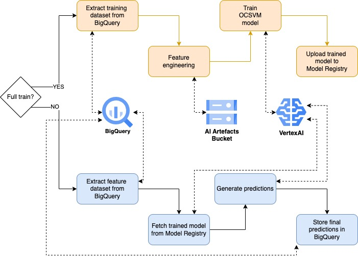

# Anomaly Detection MLOps Pipelines

[](https://github.com/Gasta88/anomaly_detection/actions/workflows/ci.yml)

Two Vertex AI pipelines written with the KFP SDK: one trains an anomaly detector on
daily new-user metrics, the other scores the most recent data and writes predictions
back to BigQuery. A synthetic data generator and the BigQuery table schemas are
included so the whole flow can be reproduced end to end in your own GCP project.

## What it does

**Training pipeline**

1. Extract the history (older than 7 days) from BigQuery.
2. Add calendar features (`day_of_week`, `day_of_month`, `month`, `quarter`).
3. Fit **one One-Class SVM per `country_code + platform + channel` combination**, with a
   `StandardScaler` in front of it.
4. Upload a single joblib artifact containing every model and its metadata, and register
   it in the Vertex AI Model Registry.

**Inference pipeline**

1. Extract the last 7 days from BigQuery and add the same calendar features.
2. Load the latest registered model artifact from Cloud Storage.
3. Score each row with the model of its own combination.
4. Append `correct` / `outlier` labels to the predictions table. Combinations that were
   not present during training are labelled `no_model` instead of guessed.



## How the model works

| Item | Value |
| --- | --- |
| Algorithm | `sklearn.svm.OneClassSVM` (`kernel="rbf"`, `gamma=0.1`, `nu=0.1`) |
| Preprocessing | `StandardScaler` fitted per combination |
| Features | `new_users`, `day_of_week`, `day_of_month`, `month`, `quarter` |
| Model granularity | one model per `country_code + platform + channel` |
| Minimum history | 10 rows per combination, otherwise the combination is skipped |
| Output labels | `correct` (inlier), `outlier` (anomaly), `no_model` (combination unseen in training) |

The dataset is generated by `data/manage_data.py`: 1000 days of daily new-user counts
for 27 combinations, with 5% of the rows randomly dropped. `nu=0.1` therefore allows
the detector to flag at most roughly 10% of the training rows per combination.

## Repository layout

```
components/                 KFP components (extract, preprocess, train, detect)
data/                       synthetic data generator and BigQuery table schemas
docs/                       architecture diagram
tests/                      offline contract tests
training_pipeline.py        compile and upload the training pipeline
inference_pipeline.py       compile and upload the inference pipeline
run_pipelines.py            submit a pipeline run to Vertex AI
Makefile                    setup, pipeline and development commands
```

## Prerequisites

- Python 3.11 or newer (the KFP components themselves run on `python:3.9` images).
- A Google Cloud project with BigQuery, Vertex AI and Cloud Storage enabled.
- The `gcloud` and `bq` CLIs installed and authenticated.
- Credentials: either Application Default Credentials
  (`gcloud auth application-default login`) or a service-account JSON key.

## Setup

```bash
cp .env.example .env      # then fill in PROJECT_ID and, if needed, BUCKET_NAME
python -m venv .venv
source .venv/bin/activate
make install
```

Environment variables (read from `.env` by Python and by the `Makefile`):

| Variable | Default | Meaning |
| --- | --- | --- |
| `PROJECT_ID` | — | GCP project (required for any `make` target that touches GCP) |
| `REGION` | `us-central1` | Vertex AI and BigQuery location |
| `ENV` | `dev` | Environment suffix used to build the default bucket name |
| `BUCKET_NAME` | `anomaly-detection-dev` | GCS bucket for pipeline artifacts |
| `DATASET_NAME` | `anomaly_detection` | BigQuery dataset |
| `INPUT_TABLE_NAME` | `new_users_metrics` | BigQuery input table |
| `OUTPUT_TABLE_NAME` | `predictions` | BigQuery predictions table |
| `SERVICE_ACCOUNT_FILE_PATH` | empty | Optional key file; empty means ADC |

## Commands

```bash
make create      # dataset, tables, bucket, synthetic data, uploaded pipelines
make insert_data # generate and insert synthetic data
make train       # submit the training pipeline
make infer       # submit the batch inference pipeline
make destroy     # delete tables, bucket and registered models
make lint        # ruff
make test        # pytest
```

## Data

`data/manage_data.py` takes one argument:

- `insert` — generate 1000 days of synthetic metrics and load them into
  `new_users_metrics`.
- `truncate` — empty the table.

The BigQuery schemas are `data/input_table_schema.json` and
`data/output_table_schema.json`.

## Testing

The test suite runs offline: Google Cloud clients are mocked, and both pipelines are
compiled locally to prove the component graph is valid.

```bash
make lint
make test
```

Covered contracts:

- preprocessing adds the calendar features and preserves row order;
- training fits one model per combination and flags an injected spike;
- detection labels each combination, marks unseen combinations `no_model`, and writes
  the expected payload to BigQuery;
- both pipelines compile without GCP credentials;
- runtime dependencies are pinned, deduplicated and complete.

## What does not run without GCP

`make create`, `insert_data`, `train`, `infer` and `destroy` need a real GCP project,
BigQuery and Vertex AI. There is no local emulator path. `make lint`, `make test` and
compiling the pipelines are fully offline.

## Limitations

- The data is synthetic; the detector is a demonstration, not a tuned production model.
- All combinations share one registered artifact (a dictionary of models), so a run
  promotes or replaces the whole set at once.
- The pipelines are submitted manually; there is no scheduler, drift monitoring or
  serving endpoint in this repository.
- The registered artifact is a custom joblib bundle (a dictionary of per-combination
  pipelines). It is consumed by the batch inference component and is not a servable
  scikit-learn model for the Vertex AI online prediction container.

## License

[MIT](LICENSE)
